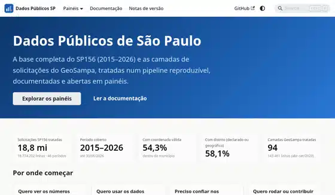

<div align="center">

# Dados Públicos de São Paulo

**Quase 19 milhões de pedidos feitos à Prefeitura pelo SP156, de 2015 a 2026, tratados, checados e transformados em painéis que qualquer pessoa consegue ler.**
*Nearly 19 million requests made to São Paulo's city hall through SP156, from 2015 to 2026, cleaned, checked and turned into dashboards anyone can read.*

<a href="https://tatyquebralayout.github.io/dados-publicos-sp/"></a>

### [▶ Ver os painéis · See the dashboards](https://tatyquebralayout.github.io/dados-publicos-sp/)

</div>

## O que tem aqui

- **Base SP156 completa:** 18.774.202 solicitações, 2015T1 a 2026T2 (CKAN do Portal de Dados Abertos).
- **94 camadas GeoSampa `sac_*`:** 143.461 solicitações, abril a setembro de 2020 (WFS).
- **Um pipeline Python testado** que baixa, limpa, valida e agrega tudo sozinho, com atualização semanal opcional.
- O projeto nasceu da camada [Reativação de um abrigo ou ponto que foi extinto](https://metadados.geosampa.prefeitura.sp.gov.br/geonetwork/srv/por/catalog.search#/metadata/5703aa4e-e3ca-4284-812a-0d1e2fde09bb), por isso o nome antigo do repositório.

## Estrutura
| Pasta | Conteúdo |
|---|---|
| `src/dados_publicos/` | pipeline: download, bronze, silver, gold, geo, qualidade, operação |
| `config/` | camadas (`layers.yaml`), catálogo WFS, códigos de distrito |
| `scripts/export_site_data.py` | gera os agregados JSON dos painéis (só agregados, sem endereços) |
| `website/` | site Docusaurus (painéis, catálogo, metodologia, guias) |
| `tests/` | testes do pipeline |
| `deploy/` | agendamento semanal (systemd/cron), não instalado automaticamente |
| `docs/metadata/` | metadado ISO 19139 original da camada de partida |

Os dados do pipeline (`data/`, 4,5 GB) **não são versionados**; reconstrua com o comando abaixo.

## Rodar
```bash
python3 -m venv .venv
.venv/bin/pip install -e '.[dev]'
.venv/bin/pytest
.venv/bin/dados-publicos update          # baixa, trata, valida e agrega
.venv/bin/python scripts/export_site_data.py
cd website && npm ci && npm start
```
Guia completo: [Executar o pipeline](https://tatyquebralayout.github.io/dados-publicos-sp/docs/guias/executar-o-pipeline).

## Limites que importam
- As camadas GeoSampa `sac_*` estão **sem atualização desde 2021**; a série longa vem do CKAN.
- O **prazo de atendimento só é confiável de 2020 em diante**.
- O layout do **2021T1** foi inferido pelo conteúdo, sem confirmação da fonte.
- Os mapas mostram contagens, **não taxas por população**.
- Projeto independente, sem vínculo oficial com a Prefeitura de São Paulo.

## Como os dados se atualizam

Toda segunda-feira às 3h17 (horário de Brasília), o workflow **Atualizar dados do SP156** (`.github/workflows/atualizar-dados.yml`) confere no portal de dados abertos da Prefeitura se saiu arquivo novo do SP156. Se não saiu, ele termina em segundos. Se saiu, ele baixa os dados e as camadas do GeoSampa, roda o pipeline e os testes e, quando tudo passa, abre um pull request só com os arquivos do site. Se algum download falha, a atualização para antes de reconstruir qualquer coisa. O site publica sozinho depois do merge, e os dados brutos nunca entram no repositório.

Para rodar na hora, abra a aba **Actions**, escolha **Atualizar dados do SP156** e clique em **Run workflow**. Ligue a opção `forcar` para reconstruir tudo mesmo sem arquivo novo.

> **Atenção:** em repositório público, o GitHub desliga os agendamentos depois de 60 dias sem commits. Como o SP156 só muda a cada três meses, isso pode acontecer entre um trimestre e outro. Se o workflow aparecer como desativado na aba **Actions**, é só reativar.

Tudo roda nas máquinas padrão e gratuitas do GitHub (`ubuntu-latest`), sem custo.

### How the data stays up to date

*Every Monday at 3:17 a.m. (Brasília time), the **Atualizar dados do SP156** workflow checks São Paulo's open data portal for new SP156 files. If there are any, it downloads them along with the GeoSampa layers, rebuilds the data, runs the tests and opens a pull request with the site files only; raw data never enters the repo. To run it by hand, open the **Actions** tab, pick the workflow and click **Run workflow** (turn on `forcar` to rebuild even with no new files). GitHub disables schedules on public repos after 60 days without commits, so re-enable the workflow there if it shows as disabled. It runs on GitHub's free standard runners.*

## Licença e dados
Os dados vêm da Prefeitura de São Paulo (CKAN: Creative Commons CCZero; GeoSampa: sem restrições, conforme os metadados). O código deste repositório está sob a [licença MIT](LICENSE). Os dados seguem a licença da fonte.

---

## 🇺🇸 English

Python pipeline, documentation and dashboards for São Paulo city open data: the full SP156 service-request base (18,774,202 requests, 2015 Q1 to 2026 Q2, from the city's CKAN portal) and 94 GeoSampa `sac_*` layers (143,461 requests, April to September 2020, via WFS). The data goes through bronze, silver and gold layers, geocoding and quality checks, with tests and a weekly update option.

**Site (dashboards and docs, in Portuguese):** https://tatyquebralayout.github.io/dados-publicos-sp/

Things to keep in mind: the GeoSampa layers haven't been updated since 2021, response times are only reliable from 2020 on, the maps show counts rather than per-capita rates, and this is an independent project with no official tie to the city government. The code is MIT-licensed; the data keeps the license of its source.
