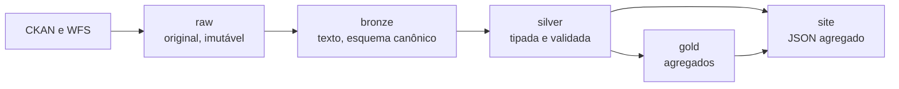

# Camadas do pipeline



| Camada | O que guarda | Formato | Tamanho |
|---|---|---|---|
| **raw** | Arquivos como foram baixados; nada é alterado | CSV, XLSX e GeoJSON, mais manifesto com SHA-256 | 3,8 GB |
| **bronze** | Todas as colunas como texto, nomes padronizados, linhas vazias removidas, uma partição por período | Parquet zstd | 336 MB |
| **silver** | Datas e números tipados, coordenadas validadas, distrito normalizado, sobreposições removidas. Particionada por `ano/mes` | Parquet zstd (Hive) | 426 MB |
| **gold** | Agregados prontos: mensal, distrito, órgão, grade 500 m, qualidade | Parquet zstd | 3 MB |

Por que **bronze em texto**? Assim nada se perde por erro de conversão: a tipagem acontece na silver, onde as falhas são contadas.

Os dados ficam em `data/`, que **não é versionado** no Git (4,5 GB). O repositório guarda o código e os agregados que alimentam o site (`website/static/data`).

## Consultando com DuckDB
```sql
SELECT ano, tema, count(*) AS n
FROM read_parquet('data/silver/sp156/**/*.parquet', hive_partitioning = true)
GROUP BY ALL ORDER BY ano, n DESC;
```
Uma consulta como esta sobre 18,7 milhões de linhas leva cerca de 0,04 s na máquina de desenvolvimento.
