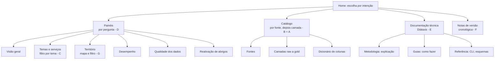

# Arquitetura da informação

Como organizar um acervo com **18,8 milhões de linhas, 94 camadas GeoSampa, 46 períodos e dezenas de métricas** para que cada leitor encontre o que procura? Comparamos sete formas de organização antes de decidir.

:::note[Como ler este estudo]
As notas abaixo são **julgamento do autor** a partir das características deste acervo, na escala de 1 (ruim) a 5 (ótimo). **Não houve teste com usuários** (card sorting, tree testing). Esse teste é a forma de validar a decisão e está listado nas pendências.
:::

## As sete formas

| # | Organização | Ideia | Quem atende melhor |
|---|---|---|---|
| A | **Por camada de dados** | raw → bronze → silver → gold | engenharia de dados |
| B | **Por fonte** | CKAN SP156, GeoSampa WFS, … | quem quer saber de onde vem |
| C | **Por tema de negócio** | Rua e bairro, Trânsito, Lixo e limpeza… | analista de política pública |
| D | **Por pergunta ou persona** | "Quanto?", "Onde?", "Posso confiar?" | leitor geral, jornalista |
| E | **Diátaxis** | tutorial, guia prático, referência, explicação | quem mantém e usa a documentação |
| F | **Cronológica** | versões e notas de atualização | quem acompanha mudanças |
| G | **Por território** | distrito → subprefeitura → cidade | gestor local, vereança |

## Critérios

1. **Descobribilidade:** o leitor encontra a resposta sem conhecer o jargão?
2. **Escala:** aguenta novas fontes e camadas sem reestruturar?
3. **Manutenção:** quanto custa manter atualizado e sem duplicação?
4. **Honestidade:** deixa visíveis os limites e anomalias dos dados?
5. **Encaixe técnico:** funciona num site estático (GitHub Pages) com os dados que temos?

| Organização | Descob. | Escala | Manut. | Honest. | Encaixe | Total |
|---|:-:|:-:|:-:|:-:|:-:|:-:|
| A. Por camada | 2 | 4 | 4 | 3 | 5 | 18 |
| B. Por fonte | 3 | 5 | 4 | 4 | 5 | 21 |
| C. Por tema | 4 | 2 | 2 | 2 | 4 | 14 |
| D. Por pergunta | 5 | 3 | 3 | 4 | 5 | 20 |
| E. Diátaxis | 3 | 5 | 4 | 4 | 5 | 21 |
| F. Cronológica | 2 | 5 | 5 | 3 | 5 | 20 |
| G. Por território | 4 | 2 | 3 | 2 | 3 | 14 |

### O que pesou em cada uma

- **A. Por camada.** Reflete a arquitetura do pipeline e é barata de manter, mas o leitor comum não sabe o que é "silver". Boa como página de **referência**, ruim como porta de entrada.
- **B. Por fonte.** É a organização mais honesta: o leitor vê de onde vem cada número, e novas fontes entram como novas seções. Vira a espinha do **catálogo**.
- **C. Por tema.** Atrai o analista, mas os 42 temas mudam de nome entre eras e a lista cresceria sem controle. Funciona melhor como **filtro dentro de um painel** do que como árvore de navegação.
- **D. Por pergunta.** Vence em descobribilidade: ninguém chega querendo "a camada gold", e sim saber "onde as solicitações se concentram". Escala menos, porque cada pergunta nova exige um painel novo. Por isso o número de painéis é limitado a seis.
- **E. Diátaxis.** Separa guias práticos, referência e explicação, o que evita misturar "como rodar" com "por que foi decidido assim". Serve para a **documentação técnica**, e não para os números.
- **F. Cronológica.** Custo mínimo e útil para acompanhar mudanças, mas ninguém navega por data para aprender algo. Fica no blog como **notas de versão**.
- **G. Por território.** Muito atraente (todo gestor quer "o meu distrito"), mas depende de normalizar por população, que ainda não foi feito, e de um dado que só 58% das linhas têm. Entra como **mapa e filtro**, não como estrutura.

## Decisão: quatro planos, cada um com sua lógica

Nenhuma forma única vence em tudo. Adotamos **uma combinação em que cada plano responde a um tipo de leitor**:

| Plano | Organização | Leitor | Onde |
|---|---|---|---|
| Painéis | por **pergunta** (D) | leitor geral | `/painel` |
| Catálogo | por **fonte**, depois por **camada** (B + A) | quem vai usar os dados | `/docs/catalogo` |
| Documentação | **Diátaxis** (E) | quem mantém e contribui | `/docs/metodologia`, `/docs/guias`, `/docs/referencia` |
| Notas de versão | **cronológica** (F) | quem acompanha | `/notas` |

Tema (C) e território (G) **não viram árvores de navegação**: aparecem como filtros e mapas dentro dos painéis.

### Princípios que decorrem da decisão
1. **Honestidade visível:** todo painel traz as limitações dos dados ao lado do gráfico (prazo só a partir de 2020, camada GeoSampa desatualizada, contagem sem normalização por população).
2. **Tabela para todo gráfico:** cada gráfico tem uma visão em tabela. Isso cumpre o requisito de acessibilidade e permite conferir o número exato.
3. **Uma fonte de verdade:** os painéis leem JSONs gerados do pipeline (`scripts/export_site_data.py`). Nenhum número é digitado à mão nas páginas, exceto os citados em texto, que devem ser revisados a cada atualização.
4. **Só agregados:** o site não publica linhas individuais, logradouros ou endereços.

## Pendências deste estudo
- Validar a decisão com **card sorting** e **tree testing** com leitores reais.
- Medir o uso real (sem coleta de dados pessoais) para saber se os seis painéis são os certos.
- Avaliar um painel "por território" com normalização por população, quando houver base populacional por distrito.
